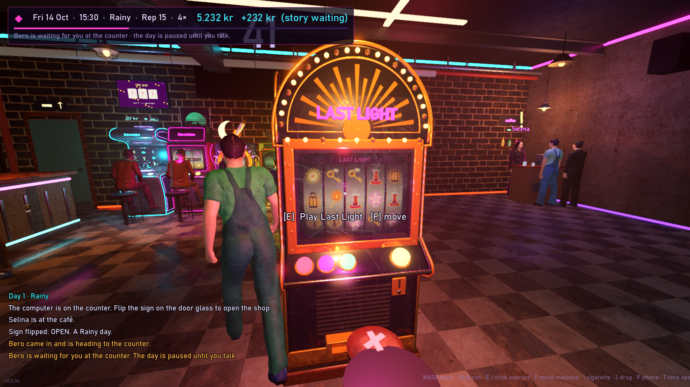
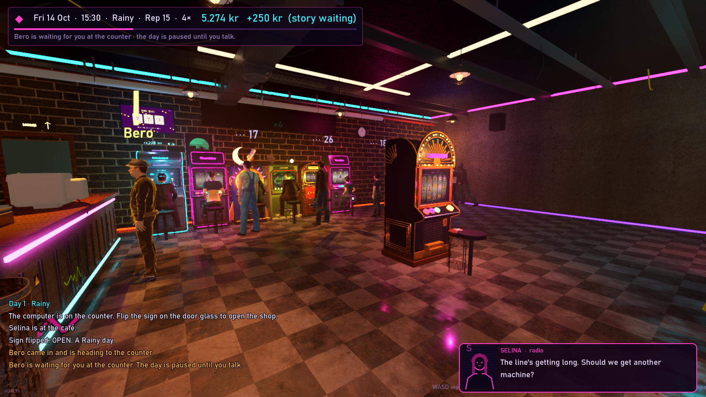

# Last Light

**A slot parlor in a purple neon city.**

> **Release date: to be announced soon.**

Last Light is a first-person shop game with a lot of talking in it. You used to pull heists. Now you own a burned-out slot parlor with one machine that still works, a baby asleep upstairs, and Selina running the café-bar in the corner. Open at ten in the morning, close at two at night, pay the rent, and listen to whoever walks in out of the rain.

## Status

| | |
|---|---|
| Stage | Alpha (0.0.x), in active development |
| Next milestone | Beta (0.1) |
| Public builds | None until the beta |
| Release date | To be announced soon |

## What you do

- **Run the shop, one day at a time.** Order machines, place them where you want, flip the sign on the door, and close the books at night. Rent and electricity are due every day.
- **Keep the room happy.** Customers queue, wander, drink, smoke, get drunk and start fights. Reputation decides how many come back tomorrow.
- **Play the Last Light yourself.** The one machine that survived the fire is yours alone. Upgrade it up to a 7×7 grid, or take it into night mode: a roguelike run of stages, targets, charms, Light Boxes and boss stages.
- **Build up Selina's café-bar.** Stock it, upgrade it, and grow it from a corner counter into a proper bar.
- **Meet people.** Story characters stop the clock when they reach the counter. Others visit on their own day of the week, on a calendar that starts on Friday 14 October 2089, and they don't wait forever.

All money in the game is fictional. There are no real-money purchases or payouts of any kind.

## Built with

- [Godot 4.7](https://godotengine.org/) and GDScript
- Blender for the models
- CC0 assets from Poly Haven, Quaternius and MakeHuman / MPFB

## Licence

Copyright © 2026 the developer of Last Light. All rights reserved.

This is not an open-source project. The code, story, art and everything else in this repository may not be used, copied, modified or redistributed without written permission. See [LICENSE](LICENSE).
