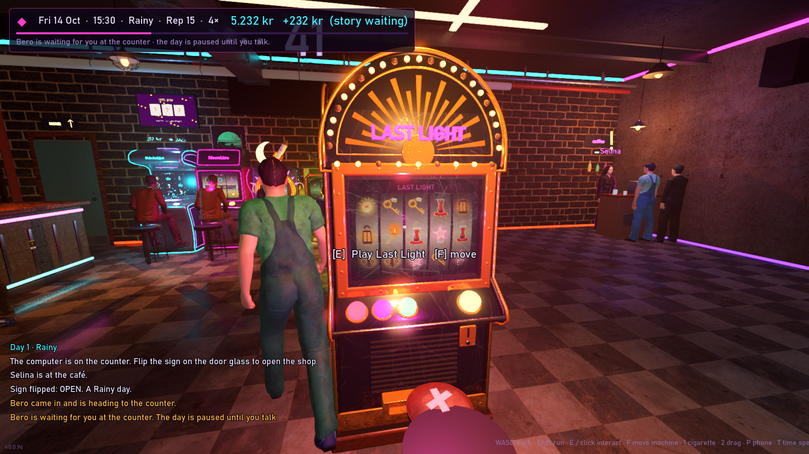
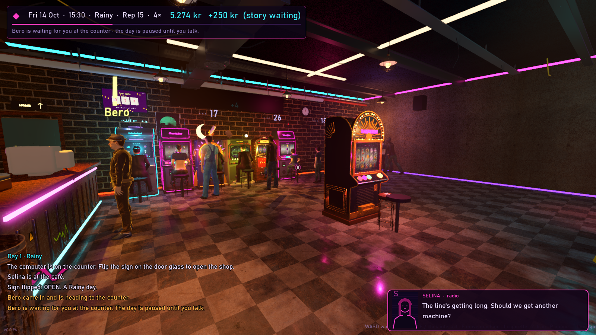

# Last Light

**A slot parlor in a purple neon city.**

> **Release date: to be announced soon.**

Last Light is a first-person shop game with a lot of talking in it. You own a slot parlor, a baby asleep upstairs, and Selina running the café-bar in the corner. Open at ten in the morning, close at two at night, pay the rent, and listen to whoever walks in out of the rain.

## Status

| | |
|---|---|
| Stage | Alpha, in active development |

| Next milestone | Beta (0.1) |

| Release date | To be announced soon |

## What you do

- **Run the shop** Order machines, place them where you want, flip the sign on the door, and close the books at night. Rent and electricity are due every day.
- **Keep the room happy.** Customers queue, wander, drink, smoke, get drunk and start fights. Reputation decides how many come back tomorrow.
- **Build up Selina's café-bar.** Stock it, upgrade it, and grow it from a corner counter into a proper bar.

## Voice actors

Lines to record, with who says them and how to say them:

- [Selina: the story](docs/voice_characters/selina_story.md)
- [Selina: the shop](docs/voice_characters/selina_store.md) (start with section 1)
- [Every character sheet, and the recording format](docs/voice_characters/README.md)
- [The demo hostess](docs/VOICE_LINES.md)
- [The characters you meet at the bar: who they are and what happens](docs/CHARACTERS.md) (spoilers)

## Built with

- [Godot 4.7](https://godotengine.org/) and GDScript
- Blender for the models

## Licence

Copyright © 2026 the developer of Last Light. All rights reserved.

This is not an open-source project. The code, story, art and everything else in this repository may not be used, copied, modified or redistributed without written permission. See [LICENSE](LICENSE).
