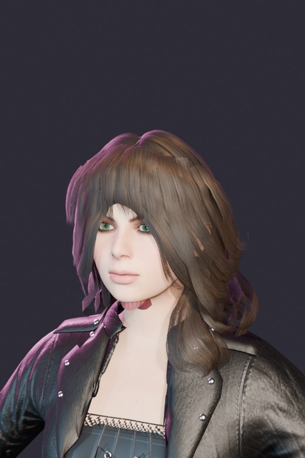
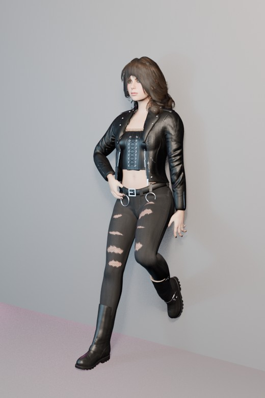
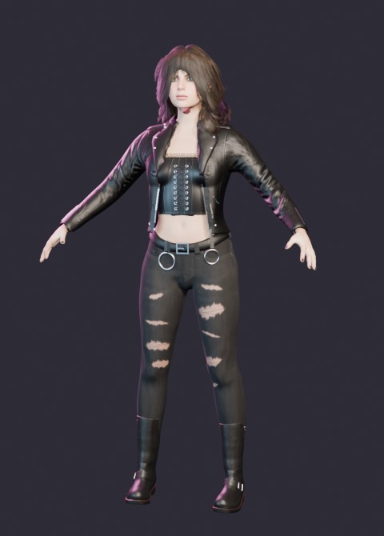
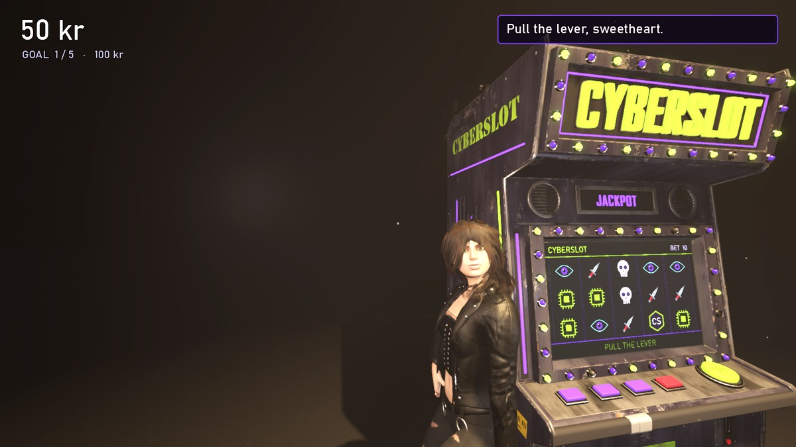
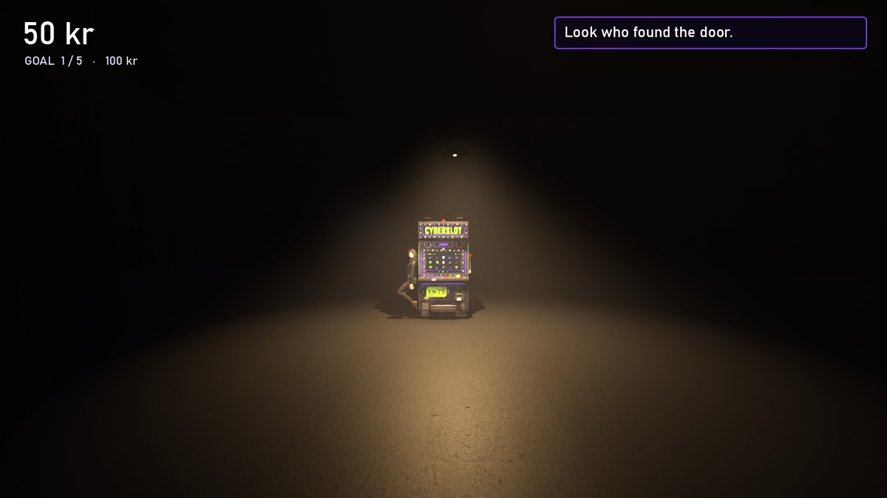

# CYBERSLOT demo — voice lines for the hostess

35 lines. Record each line as its own file, name it exactly as in the "File" column, and drop it into:

`assets/audio/demo/voice/`

Nothing else is needed. The next time the demo starts, any line that has a file plays with that voice, her mouth moves for the length of the recording, and the music dips while she speaks. Lines without a file still show as text only, so you can record them in any order.

## The character

**Who you are voicing:** the hostess of the CYBERSLOT machine. She has no name in the demo.

| Her face | How she stands | Her outfit |
|---|---|---|
|  |  |  |

- **Age and look:** late twenties. Shoulder-length wavy dark-brown hair with bangs, green eyes. Open black leather jacket, black lace-up top, ripped black jeans over fishnet, heavy boots.
- **What she does:** nothing. For the whole demo she leans against the side of the machine with one boot up on it, a thumb hooked in her belt. She never walks and never gestures. Only her head turns to follow the player, and her mouth moves when she speaks. So everything she is has to come through the voice.
- **Where she is:** a room so big and dark you cannot see the walls. One old lamp sways above a single slot machine. There is no one else.

- **Who she is talking to:** the player, a stranger who has just walked in. The player pulls the lever; she watches and comments. Each line is one short remark tossed at the player after a spin, not a conversation.
- **What happens:** the player has to hit five money goals on the machine. She mocks every loss and is almost impressed by a win. After the fifth goal she holds out a cigarette, the player smokes it, and a giant screen comes down from the ceiling with the game's title.
- **Distance:** she is two or three metres from the player, in a silent room. She never needs to project. Think close microphone, low volume, no hurry.
- **Language and accent:** English. Any natural accent is fine as long as it stays the same in every line.

## Recording format

| Setting | Value |
|---|---|
| File type | `.wav` (best). `.ogg` or `.mp3` also work |
| Channels | Mono |
| Sample rate | 44,100 Hz or 48,000 Hz |
| Bit depth | 16-bit (for WAV) |
| File name | lowercase, exactly as listed, for example `intro_1.wav` |
| Silence | Trim to almost nothing at the start; leave about 0.2 s at the end |
| Level | Peaks around -3 dB, same loudness across all files |
| One line per file | Yes |

## Who she is

She works the room and has seen everyone lose. Dry, amused, unhurried, a little flirtatious. She never raises her voice and never sounds surprised, except once: line `big_1`. Short lines land best thrown away, almost under her breath.

## Opening (played in order when the demo starts, until the first spin)

| File | Line | Direction |
|---|---|---|
| `intro_1.wav` | Look who found the door. | Mild surprise, not looking up yet |
| `intro_2.wav` | Go on. She doesn't bite. I might. | "She" is the machine. Smile on "I might" |
| `intro_3.wav` | Pull the lever, sweetheart. Five little goals and I'll let you out. | Explaining the rules as if they bore her |

## After a small win (one picked at random)

| File | Line | Direction |
|---|---|---|
| `win_1.wav` | Cute. | Flat, one beat |
| `win_2.wav` | Beginner's luck looks good on you. | Teasing |
| `win_3.wav` | Mm. Do that again. | Low, pleased |
| `win_4.wav` | See? She likes you. | "She" is the machine |
| `win_5.wav` | Don't get cocky. | Warning with a smile |
| `win_6.wav` | There it is. | Quiet satisfaction |
| `win_7.wav` | Now you're pulling like you mean it. | Approving |

## After a big win (one picked at random)

| File | Line | Direction |
|---|---|---|
| `big_1.wav` | Oh. Oh, that's obscene. | The one time she is caught off guard |
| `big_2.wav` | Now you've got my attention. | Slower, interested |
| `big_3.wav` | Careful. Keep winning like that and I'll have to like you. | Dry |

## After a loss (one picked at random)

| File | Line | Direction |
|---|---|---|
| `lose_1.wav` | Ouch. | Mock sympathy |
| `lose_2.wav` | That one hurt to watch. | Mock sympathy |
| `lose_3.wav` | She's just warming up. So am I. | "She" is the machine |
| `lose_4.wav` | You pull like you're apologising. | Needling |
| `lose_5.wav` | Try it with feeling. | Bored instruction |
| `lose_6.wav` | My grandmother loses faster. Barely. | Pause before "Barely" |
| `lose_7.wav` | Don't look at me. I only work here. | Shrug in the voice |
| `lose_8.wav` | The house says thank you. | Sweetly |

## Goals

| File | Line | When | Direction |
|---|---|---|---|
| `goal_1.wav` | One down. Don't faint. | Goal 1 reached | Dry |
| `goal_2.wav` | Two. You're almost interesting. | Goal 2 reached | Dry |
| `goal_3.wav` | Three. The room's getting warmer. | Goal 3 reached | Warming up, slightly |
| `goal_4.wav` | Four. One more and I owe you something. | Goal 4 reached | A promise |
| `goal_5.wav` | Five. Well, well. Nobody gets five. | Goal 5 reached | Genuinely impressed, slow |

## When the player wanders off without spinning (one picked at random)

| File | Line | Direction |
|---|---|---|
| `nag_1.wav` | The machine's over here, tourist. | Calling across the room, still not loud |
| `nag_2.wav` | Walk all you want. There's nothing out there. | Matter of fact |
| `nag_3.wav` | I'm on the clock, you know. | Impatient |
| `nag_4.wav` | It won't pull itself. I've asked. | Deadpan |

## Single moments

| File | Line | When | Direction |
|---|---|---|---|
| `gift.wav` | On the house. Don't make it a habit. | The player runs out of money and she tops them up | Indulgent |
| `offer.wav` | A deal's a deal. Come here. You've earned the bad habit. | After goal 5, as she holds out the cigarette | Inviting |
| `smoke.wav` | Slow. It's the only thing in this room that isn't rigged. | As the player takes the cigarette | Quiet, almost kind |
| `look_up.wav` | Now look up. | After the cigarette is flicked away, before the spotlights | Soft command |
| `bye.wav` | See you in the city. | After the big screen lights up | A goodbye that is also a promise |

## Changing a line

The text lives at the top of `demo/demo.gd` in the `LINES` list. If you want a line reworded, tell me the file name and the new wording; the file name stays the same.
